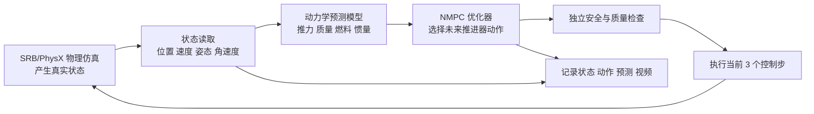

# NMPC 专家系统及 15 m 同步逼近实验汇报

**面向对象：**不需要预先了解 NMPC、acados 或航天器动力学的听众  
**实验日期：**2026-09-22  
**实验目录：**`logs/nmpc_15m_sync_20260922/full`

## 一、先说结论

这次实验验证了一个完整的闭环控制流程：模拟航天器从距离目标约 15 m 的位置出发，在飞行过程中同时调整位置和姿态，最终到达目标卫星正面约 30 cm 的位置，并稳定保持。

实验运行了 150 s，共 3000 个实际仿真步，没有中途停止、没有碰撞、没有被 NMPC 的质量检查拒绝。最终结果是：

| 指标 | 结果 | 直观含义 |
|---|---:|---|
| 初始距离 | 约 15.002 m | 从较远距离开始，而不是从目标附近微调 |
| 同步逼近时间 | 120 s | 位置和姿态沿同一个平滑进度同时变化 |
| 最终位置误差 | `2.85×10⁻⁷ m` | 数值上几乎到达设定位置 |
| 最终姿态误差 | `4.83×10⁻⁶°` | 数值上几乎完成对准 |
| 目标正面间距 | `0.300000284 m` | 达到 30 cm 面间距要求 |
| 最终横向误差 | `3.07×10⁻⁸ m` | 几乎正对目标面中心 |
| 最长稳定保持 | 36.3 s | 连续满足末端速度、姿态和间距要求 |
| 全程最小网格安全间隔 | 0.1777 m | 实际模型表面之间始终保持正间隔 |
| 最大速度 | 0.2273 m/s | 逼近过程中的最高平移速度 |
| 最大接触力 | 0 N | 没有发生接触 |
| 剩余燃料 | 3.663 kg | 按当前仿真燃料模型消耗约 1.337 kg |

视频也通过了完整性检查：H.264、960×540、20 fps、150 s、3000 帧，完整解码成功。

这些结果说明：**当前 NMPC 已经能够在 SRB 物理仿真中完成一次从远距离出发、位置和姿态同步变化、最后稳定到达的闭环专家控制实验。**这是一项成功的仿真验证，但还不能直接等同于真实航天器上的实时飞行能力或通用任务成功率。

## 二、我们到底在控制什么

可以把任务想象成“让一个带有 16 个小型推进器的航天器，飞到目标卫星前方指定位置，并把姿态转到正确方向”。它同时要解决三个问题：

1. 现在在哪里、速度多大、朝向哪里？
2. 下一小段时间应该怎样点火，才能逐渐接近目标？
3. 点火过程中会不会进入禁入区、速度过高、姿态失控或撞上目标？

NMPC 的作用类似一个会不断重新规划的导航员：它不是一次性生成整段固定动作，而是每隔一小段时间读取真实状态，再重新计算接下来应该怎么做。

## 三、系统由哪些关键部分组成



### 1. SRB/PhysX：负责“真实执行”

SRB 是实验环境，PhysX 是其中负责刚体运动和碰撞的物理引擎。NMPC 不直接修改航天器的位置或姿态；它只能发送推进器动作，之后的位置、速度和姿态由物理引擎积分得到。

本次实验使用 GPU Kit 渲染视频，Kit 设备为 `cuda:1`；SRB 环境张量、PhysX 兼容张量和 NMPC 求解均使用 CPU。这是两个不同的层次：GPU 主要负责仿真应用和渲染，控制器使用 CPU 读取状态并求解。

### 2. 状态：控制器每次看到的“当前情况”

控制器使用 13 个状态量：

\[
x=[位置(3),\;速度(3),\;姿态四元数(4),\;角速度(3)].
\]

它们分别回答“在哪里”“移动多快”“朝向哪里”和“转得多快”。姿态用四元数表示，是为了避免欧拉角在大角度运动时出现奇异问题。

### 3. 推进器和执行器模型：把动作变成力和力矩

优化器真正选择的是 16 个推进器的占空比，而不是直接指定一个位移。每个占空比在 0 到 1 之间，经过 RCS 几何映射后形成三轴合力和三轴合力矩：

\[
\begin{bmatrix}F\\\tau\end{bmatrix}=B u,
\]

其中 `u` 是 16 维推进器动作，`B` 是由推进器方向、安装位置和质心决定的 6×16 矩阵。这样，控制器必须面对真实执行器的限制：某个方向的力可能需要多个推进器共同产生，反向推进器不能无限同时打开，动作也不能瞬间跳变。

### 4. 动力学模型：预测“点火后会怎样”

当前新实验采用与 SRB 执行器对齐的自由漂浮模型。它不使用历史 HCW 轨道项，而是直接预测推进器对刚体的影响：

\[
v_{k+1}=v_k+\Delta t\,R(q_k)F_k/m_k,
\qquad
r_{k+1}=r_k+\Delta t\,v_{k+1}.
\]

姿态部分使用刚体转动方程：

\[
J\dot\omega+\omega\times(J\omega)=\tau.
\]

模型还跟踪燃料和湿质量：推进器动作会减少燃料，质量下降后，同样的推力会产生略大的加速度。当前仿真车辆的干质量约为 6.109 kg，满燃料质量约为 11.109 kg。第一股力施加前，PhysX 已经同步安装湿质量和相应惯量。

需要区分两种模型：仓库中的历史路径是“HCW/CW 相对轨道动力学 + 五子步 RK4”；当前实验是“自由漂浮 + 与 PhysX 对齐的离散执行器模型”。两者都保留，是为了兼容历史实验；新实验使用后者。

### 5. NMPC 优化器：在约束下挑选动作

每次求解时，控制器会向前看一段预测窗口。本次配置为：

- 控制周期：0.05 s，即 20 Hz；
- 预测长度：40 步，即 2 s；
- 每次求解后执行 3 个连续控制步，再重新求解；
- 求解器：acados + SQP-RTI + HPIPM；
- 代价：位置、速度、姿态、角速度、推进器用量和动作变化率。

优化器不仅追求“离目标近”，还必须满足硬约束：推进器上下限、动作变化率、速度和角速度上限、反向推进器约束、禁入区外部条件，以及可选的相机视场约束。

### 6. 独立质量门：防止“求解器说成功，但动作不能执行”

acados 返回数值成功后，系统还会用同一组实际推进器动作重新 rollout，并独立检查：

- 预测轨迹是否符合动力学；
- 四元数是否保持单位长度；
- 预测过程中是否碰到禁入区或速度边界；
- 动作是否违反占空比变化率和成对推进器限制。

因此，`solver status=success` 只表示优化器完成了计算；只有通过 `quality_verdict=accepted`，动作才被允许进入执行和示范数据。

## 四、本次实验是怎样设计的

### 任务设置

航天器从相对目标根部位置 `[-15.0, 0.2, 0.15] m` 出发，距离约 15.002 m。目标是到达目标卫星指定正面前方 0.30 m，并将航天器顶面转向目标正面。初始姿态为单位姿态，目标姿态约为绕 Y 轴 90° 的姿态变化。

本次新增的是“同步逼近”参考：位置和姿态使用同一个五次多项式进度从起点变化到目标。它可以理解为一个平滑的进度旋钮 `s(t)`：开始和结束时速度、加速度都为零，中间逐渐加速再减速。重要的是，这条曲线只是给 NMPC 的目标参考，航天器仍然必须通过推进器和物理引擎实际完成运动；程序没有逐帧把姿态或位置强行设置到曲线上。

同步逼近持续 120 s，之后保持目标 30 s，总实验时长 150 s。目标判据为：正面间距 0.30±0.02 m、横向误差小于 0.02 m、完整姿态误差小于 5°、速度小于 0.05 m/s、角速度小于 0.05 rad/s，并持续至少 1 s。

### 实际运行命令

工作目录为 `/home/ubuntu/yyf/space_robotics_bench_0.0.5`，正式实验命令为：

```bash
env -u CUDA_VISIBLE_DEVICES \
CUDA_DEVICE_ORDER=PCI_BUS_ID \
OMP_NUM_THREADS=1 \
OPENBLAS_NUM_THREADS=1 \
timeout -k 15 900 \
./srb_0.0.5_env.sh -- \
/home/ubuntu/isaac-sim-4.5/python.sh -u \
scripts/validate_nmpc_replay.py replay \
--plan logs/nmpc_validation_20260907/approach_hcw_plan \
--output logs/nmpc_15m_sync_20260922/full \
--video --stable-video-lighting --video-fill-intensity 600 \
--surface-display-materials --device cuda:1 \
--closed-loop --matched-executor --surface-approach \
--surface-sync 120 --horizon-steps 40 --execute-steps 3 \
--steps 3000 --seed 0 --start -15 0.2 0.15 \
--target-position 0 0 0
```

本次为了录制视频，未使用 `--physics-only`；因此视频路径包含渲染，而动力学与控制仍按 CPU PhysX/NMPC 配置运行。

## 五、实验结果怎样理解

### 1. 它确实完成了“从远处到目标”的闭环任务

3000 个步长全部执行完成，控制器没有因为优化失败、质量门拒绝或环境提前结束而停止。最终面间距为 0.300000284 m，横向误差约 0.000000031 m，朝向误差约 0.0000049°。这些数值远小于任务判据，说明末端对准非常充分。

### 2. 这不是只看最后一帧

全程还检查了几何安全性。航天器和目标实际网格的最小支持平面间隔为 0.1777 m，最大速度为 0.2273 m/s，最大接触力为 0 N。最后 36.3 s 持续满足末端间距、横向误差、姿态、速度和角速度条件。

因此，结论不是“最后恰好到了一次”，而是“沿着一条真实物理执行轨迹到达，并在末端保持了一段时间”。

### 3. 计算速度满足本次三步重规划节奏，但还不能称为实时飞控证明

NMPC 热启动求解时间 P50/P99 为 63.35/85.12 ms。控制器每次求解后执行 3 个 0.05 s 步，也就是约 150 ms 后才需要下一次规划，所以本次记录的重规划 deadline miss fraction 为 0。

但单个求解的 P99 仍高于 50 ms 的单步控制周期，而且实验仿真会等待求解完成后再推进。它证明了“在当前同步仿真节奏下可以连续运行”，尚未证明在真实墙钟、传感器延迟、通信延迟和并行负载下仍能满足实时控制要求。

### 4. 燃料结果可以用于比较，不应直接当作真实航天器耗油量

实验结束剩余燃料约 3.663 kg，当前模型中约消耗 1.337 kg。这个数值反映的是 SRB 当前推进器功率和燃料消耗模型下的控制代价，可用于不同控制策略之间的相对比较；它还不是经过真实发动机标定的工程耗油预测。

## 六、这组实验已经证明和没有证明的事情

### 已经有直接证据的结论

- NMPC 能够读取 SRB 的实际反馈状态并进行滚动重规划。
- matched free-floating 模型能够处理位置、姿态、质量、燃料和 16 通道推进器的耦合。
- 位置和姿态可以在同一个平滑参考过程中同时逼近。
- 15 m 初始距离的单次闭环仿真可以完整到达 30 cm 正面间距。
- 到达过程没有接触，末端可以持续保持。
- 状态、动作、预测轨迹、求解记录、物理审计和视频都已保存，具备后续专家示范数据分析条件。

### 目前不能从这一次实验推出的结论

- 不能推出真实航天器可以直接使用同样的参数和耗油量；
- 不能推出所有初始位置、速度、姿态和扰动都能成功；
- 不能推出已满足严格实时飞控要求；
- 不能推出对未建模的传感噪声、执行器延迟、推力误差和结构效应具有鲁棒性；
- 不能把一次成功轨迹当作统计意义上的成功率或全局最优轨迹。

当前模型仍采用随质量比例变化的惯量近似，并未完整表示燃料箱几何、质心移动、推进器瞬态和传感延迟。下一步应使用多组初始状态、扰动和参数偏差重复实验，并单独测量带真实延迟的墙钟性能。

## 七、面向后续模仿学习的意义

这次实验的价值不只是“控制器到达了目标”，还在于它产生了可检查的专家示范：每个时间点都有实际状态、实际执行的 16 通道动作、目标参考、预测轨迹、质量/燃料信息和求解器记录。

后续训练 ACT 或 Diffusion Policy 时，应使用闭环中真正执行的动作作为标签。NMPC 在某一时刻预测的未来动作，可能在下一次读取真实状态后被重新规划，因此不能把整条预测序列误认为未来一定会执行的动作。失败、被质量门拒绝和正常执行的片段也应分开记录。

## 八、实验曲线

以下图表全部由正式实验记录重算得到。蓝色背景表示 0–120 s 同步逼近阶段，绿色背景表示 120–150 s 末端保持阶段，虚线是目标或约束边界。

- [汇总图 PNG](/home/ubuntu/yyf/space_robotics_bench_0.0.5/logs/nmpc_15m_sync_20260922/full/nmpc_15m_sync_summary.png) / [PDF](/home/ubuntu/yyf/space_robotics_bench_0.0.5/logs/nmpc_15m_sync_20260922/full/nmpc_15m_sync_summary.pdf)
- [速度、加速度、角速度和 jerk](/home/ubuntu/yyf/space_robotics_bench_0.0.5/logs/nmpc_15m_sync_20260922/full/nmpc_15m_sync_kinematics.png)
- [位置逼近、面间距、姿态对准和网格安全间隔](/home/ubuntu/yyf/space_robotics_bench_0.0.5/logs/nmpc_15m_sync_20260922/full/nmpc_15m_sync_approach.png)
- [推力、力矩、燃料、占空比和求解时间](/home/ubuntu/yyf/space_robotics_bench_0.0.5/logs/nmpc_15m_sync_20260922/full/nmpc_15m_sync_resources.png)

## 九、材料位置

- 第一篇模型说明：[`nmpc_model_technical_report_20260922.md`](/home/ubuntu/yyf/space_robotics_bench_0.0.5/docs/src/workflows/nmpc_model_technical_report_20260922.md)
- 正式实验视频：[`replay.mp4`](/home/ubuntu/yyf/space_robotics_bench_0.0.5/logs/nmpc_15m_sync_20260922/full/replay.mp4)
- 实验汇总指标：[`replay.json`](/home/ubuntu/yyf/space_robotics_bench_0.0.5/logs/nmpc_15m_sync_20260922/full/replay.json)
- 实际状态与动作：[`replay.npz`](/home/ubuntu/yyf/space_robotics_bench_0.0.5/logs/nmpc_15m_sync_20260922/full/replay.npz)
- NMPC 预测与接受记录：[`predictions.npz`](/home/ubuntu/yyf/space_robotics_bench_0.0.5/logs/nmpc_15m_sync_20260922/full/predictions.npz)、[`solver_records.json`](/home/ubuntu/yyf/space_robotics_bench_0.0.5/logs/nmpc_15m_sync_20260922/full/solver_records.json)
- 物理参数审计和运行命令：[`physics_audit.json`](/home/ubuntu/yyf/space_robotics_bench_0.0.5/logs/nmpc_15m_sync_20260922/full/physics_audit.json)、[`invocation.json`](/home/ubuntu/yyf/space_robotics_bench_0.0.5/logs/nmpc_15m_sync_20260922/full/invocation.json)
